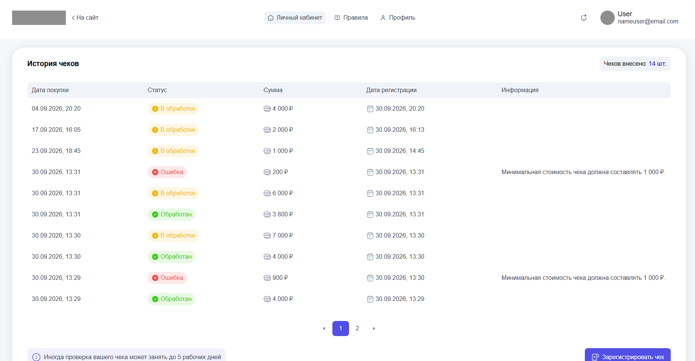

# Next.js/DRF «Чек на удачу»

Веб-сервис для регистрации и модерации кассовых чеков в рамках промо-акций. 
Поднимается в Docker Compose (Django REST Framework + Next.js + PostgreSQL).

## Технологический стек
- **Backend:** Python 3.12, Django 5.1, Django REST Framework (DRF)
- **Database:** PostgreSQL 16
- **Frontend:** React 19, Next.js
- **Infra & CI:** Docker Compose, GitHub Actions (линтеры + тесты)

## Скриншот личного кабинета


## Как запустить проект

1. Склонируйте репозиторий.
   ```bash
   git clone git@github.com:AncientSteal/lucky-receipts-next-drf.git
   ```
2. В корне проекта создайте файл `.env` (можно просто скопировать из примера):
   ```bash
   cp .env.example .env
   ```
3. Запустите Docker Desktop на своём устройстве, а затем сборку и старт контейнеров:
   ```bash
   docker compose up --build
   ```
4. После успешного запуска всех сервисов откройте в браузере: **`http://localhost:8000/`**

**Важно для Production:** Текущий `SECRET_KEY` в `.env.example` предназначен только для локального тестирования. При деплое на боевой сервер необходимо сгенерировать уникальный ключ (например, через `django.core.management.utils.get_random_secret_key()`).

## Тестовые доступы (Данные для проверки)
Для тестирования после выполнения сборки и запуска контейнера автоматически будет создан аккаунт администратора, если таковой отсутствовал:
- **Логин:** `admin`
- **Пароль:** `admin1234`

### Сценарий проверки:
1. Перейдите на `http://localhost:8000/`. Вас автоматически перенаправит на главную страницу. Или сразу откройте главную страницу приложения `http://localhost:3000/` и нажмите «Войти / Регистрация».
2. Введите указанные выше доступы или зарегистрируйтесь под новыми. Вас перенаправят на фронтенд личного кабинета (`http://localhost:3000/cabinet`).
3. Для проверки панели модератора перейдите в админку: `http://localhost:8000/admin/`.

### Покрытие Unit-тестами (PyTest): 
Логика валидации чеков (проверка минимальной суммы, валидация временных рамок акции из `.env` и уникальность реквизитов), 
защита от BOLA уязвимости и работа основного Viewset, а также ограничения при редактировании чека в панели админа 
покрыты тестами с использованием современного стека `pytest` и `pytest-django` через фикстуры. 
Тесты запускаются изолированно в Docker.

### Запуск тестов:
```bash
docker compose exec backend pytest -v
```

### Стейт-менеджмент (Фронтенд)

Для управления глобальным состоянием приложения и оптимизации производительности рендеринга внедрена библиотека **Zustand**.

### Что было успешно исправлено при переходе на Next.js & TS:
* **Типизация и семантика:** JS компоненты были переписаны на TypeScript.
* **Гибридная архитектура и оптимизация SSR:** 
  Основной каркас приложения (`RootLayout`) спроектирован как серверный компонент, что позволяет отдавать базовую структуру и SEO напрямую с сервера. 
  Компоненты с директивой `"use client"` по-прежнему проходят стадию предварительного рендеринга на сервере, гарантируя, что поисковые роботы увидят семантическую разметку и навигационные ссылки сразу в исходном HTML.
* **Ликвидация сквозного стейта:** Архитектура экранов полностью отвязана от ручного переключения табов на клиенте и переведена на декларативный роутинг платформы Next.js.
* **Форма логина и регистрации** Теперь встроенная форма DRF для логина заменена на кастомную форму входа, которая доступна с главной страницы.

### Ключевые архитектурные особенности:
* **Изолированные хранилища (Stores):** Логика авторизации пользователя (`useUserStore`) и пагинации/загрузки чеков (`useReceiptsStore`) вынесены из структуры компонентов React во внешние модули как хранилища Zustand.
* **Атомарные подписки:** Компоненты подписываются на изменения состояния точечно через селекторы / хук useShallow, что предотвращает перерисовывания, свойственные стандартному React Context.
* **Работа с данными и валидация:** Единые Zod-схемы на фронте валидируют как пользовательский ввод, так и контракты ответов от API. Гонки запросов и таймауты обрабатываются через `AbortSignal.any()`.
* **Библиотека для форм** React Hook Form работает вместе с Zod схемами, чтобы снизить количество лишних ререндеров страницы формы.
* **Разделение роутинга и SSR/CSR:** Внутри Docker-сети Next.js ходит в бэкенд по внутреннему имени сервиса (`backend:8000`), а клиентские запросы из браузера идут на публичный хост (разруливается через `getApi.ts`, которая автоматически определяет базовый URL в зависимости от среды выполнения). Модальные окна вынесены в Parallel Routes.
* **Безопасность и бизнес-логика (Backend):**
  * Валидация чеков: проверка даты проведения акции (задаётся через `.env`), минимальной суммы и уникальности фискальных данных (`fn`, `i`, `fp`).
  * Изоляция данных пользователей (доступ строго к своим чекам) и rate-limiting (throttling) на эндпоинты авторизации.

### Поле автоматического заполнения формы из строки QR-кода
Часто при регистрации чеков в реальных промо-акциях камера смартфона в браузере не может сфокусироваться на QR-коде. Для решения этой проблемы в форму добавлен альтернативный инструмент — **поле быстрой вставки сырой строки QR-кода**.

- Вся логика парсинга вынесена в изолированную утилиту `frontend/src/app/utils/parseQrString.ts`. Разбор параметров строки реализован через браузерный класс `URLSearchParams`. Системный формат даты чека `YYYYMMDDTHHMMSS` автоматически переводится регулярным выражением в формат `YYYY-MM-DDTHH:MM`.

   **Пример 1 (Валидный чек на 1850 руб):** 
  `t=20260930T145500&s=1850.20&fn=9999456789123456&i=7788&fp=33445566`

   **Пример 2 (Валидный чек на 3200 руб):** 
  `t=20261001T154500&s=3200.00&fn=1111222233334444&i=8899&fp=99887766`

### Ближайшие планы по масштабированию:

**Распознавание чеков «роботами» (OCR / QR-Scanner):**
* Загрузка фото чека и распознавание QR-кода на бэкенде (`pyzbar` / OpenCV). Соответственно и внедрение `Pillow` в работу.

**Оптимизация фоновых задач:**
* Асинхронная проверка чеков через API ФНС в фоне (`Celery` + `Redis`).

