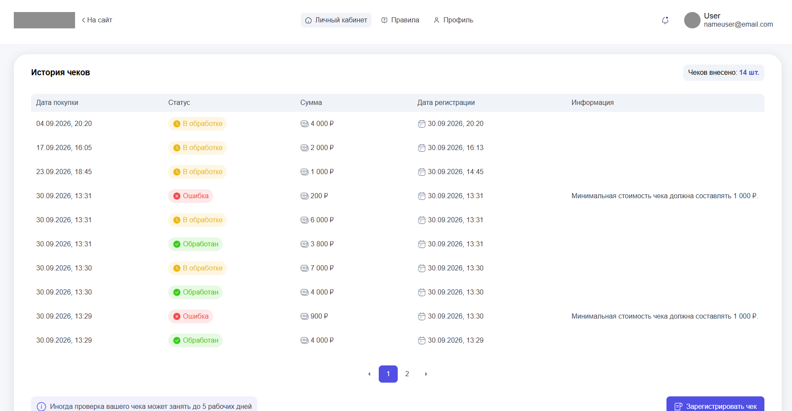

# Промо-акция «Чек на удачу» (Test Task)

Перенесённое MVP-приложение для регистрации и модерации чеков покупателей и адаптированное под архитектуру Next.js + DRF.

## Технологический стек
- **Backend:** Python 3.12, Django 5.1, Django REST Framework (DRF)
- **Database:** PostgreSQL 16
- **Frontend:** React 19, Next.js
- **Infrastructure:** Docker, Docker Compose

## Скриншот личного кабинета


## Как запустить проект

1. Склонируйте репозиторий.
   ```bash
   git clone git@github.com:AncientSteal/lucky-receipts-next-drf.git
   ```
2. В корне проекта создайте файл `.env` (можно просто скопировать из примера):
   ```bash
   cp .env.example .env
   ```
3. Запустите Docker Desktop на своём устройстве, а затем сборку и старт контейнеров:
   ```bash
   docker compose up --build
   ```
4. После успешного запуска всех сервисов откройте в браузере: **`http://localhost:8000/`**

**Важно для Production:** Текущий `SECRET_KEY` в `.env.example` предназначен только для локального тестирования. При деплое на боевой сервер необходимо сгенерировать уникальный ключ (например, через `django.core.management.utils.get_random_secret_key()`).

## Тестовые доступы (Данные для проверки)
Для тестирования функционала после выполнения сборки и запуска контейнера автоматически будет создан аккаунт администратора, если таковой отсутсвовал:
- **Логин:** `admin`
- **Пароль:** `admin1234`

### Сценарий проверки:
1. Перейдите на `http://localhost:8000/`. Вас автоматически перенаправит на форму авторизации, если вы ещё не зарегистрировались.
2. Введите указанные выше доступы. Сервер авторизует вас и автоматически перенаправит на фронтенд-приложение Личного кабинета (`http://localhost:3000`).
3. Для проверки панели модератора перейдите в админку: `http://localhost:8000/admin/`.

### Покрытие Unit-тестами (PyTest): 
Вся ключевая бизнес-логика валидации чеков (проверка минимальной суммы, валидация временных рамок акции из `.env` и уникальность реквизитов), 
защита от BOLA уязвимости и работа основного Viewset, а также ограничения при редактировании чека в панели админа 
покрыты тестами с использованием современного стека `pytest` и `pytest-django` через фикстуры. 
Frontend логика также была протестирована при помощи Vitest.
Тесты запускаются изолированно в Docker.

### Запуск тестов:
```bash
docker compose exec backend pytest -v
```

### Стейт-менеджмент (Фронтенд)

Для управления глобальным состоянием приложения и оптимизации производительности рендеринга внедрена библиотека **Zustand**.

### Что было успешно исправлено при переходе на Next.js & TS:
* **Типизация и семантика:** JS компоненты были полностью переписаны на TypeScript.
* **Интеграция SSR*** Основной layout компонент теперь содержит навиагционные панели и заголовки, которые рендерятся на стороне сервера.
* **Ликвидация сквозного стейта:** Архитектура экранов полностью отвязана от ручного переключения табов на клиенте и переведена на декларативный роутинг платформы Next.js.

#### Ключевые архитектурные изменения:
* **Изолированные хранилища (Stores):** Логика авторизации пользователя (`useUserStore`) и пагинации/загрузки чеков (`useReceiptsStore`) полностью вынесены из структуры компонентов React во внешние модули.
* **Атомарные подписки (Selectors):** Компоненты подписываются на изменения состояния точечно через селекторы, что предотвращает каскадные избыточные перерисовывания, свойственные стандартному React Context.
* **Сетевая оптимизация:** Асинхронные запросы инкапсулированы внутри экшенов Zustand. Интегрированы встроенные механизмы `AbortController` и `AbortSignal.any()` для предотвращения гонок запросов при быстрой пагинации и автоматической отмены зависших запросов по таймауту (5 секунд).

### Поле автоматического заполнения формы из строки QR-кода
Часто при регистрации чеков в реальных промо-акциях камера смартфона в браузере не может сфокусироваться на QR-коде. Для решения этой проблемы в форму добавлен альтернативный инструмент — **поле быстрой вставки сырой строки QR-кода**.

- Вся логика парсинга полностью декомпозирована и вынесена из React-компонента в изолированную утилиту `frontend/src/app/utils/parseQrString.ts`. Разбор параметров строки реализован через нативный браузерный класс `URLSearchParams`. Системный формат даты чека `YYYYMMDDTHHMMSS` автоматически переводится регулярным выражением в валидный для HTML5 формат `YYYY-MM-DDTHH:MM`.

   **Пример 1 (Валидный чек на 1850 руб):** 
  `t=20260930T145500&s=1850.20&fn=9999456789123456&i=7788&fp=33445566`

   **Пример 2 (Валидный чек на 3200 руб):** 
  `t=20261001T154500&s=3200.00&fn=1111222233334444&i=8899&fp=99887766`

### Ближайшие планы по масштабированию системы:

**Асинхронное распознавание чеков «роботами» (OCR / QR-Scanner):**
* Добавление возможности загрузки фотографий чеков (`.jpg`, `.png`) через форму `ReceiptForm` с использованием `Multipart Form Data`.
* Интеграция на бэкенде (DRF) конвейера обработки изображений с помощью библиотек `Pillow` и `OpenCV` для предварительной фильтрации, выравнивания и повышения контрастности загруженного снимка.
* Подключение легковесного микросервиса на базе библиотеки `pyzbar` / `Tesseract OCR` для автоматического поиска, декодирования QR-кода и извлечения сырой строки параметров прямо из картинки.

**Оптимизация фоновых задач (Celery + Redis):**
* Вынос процесса распознавания и валидации чеков через API Федеральной налоговой службы (ФНС) в асинхронные воркеры `Celery`, чтобы тяжелый процесс сканирования изображений роботами не блокировал основной поток бэкенда Django и не заставлял клиента ждать ответа по таймауту.